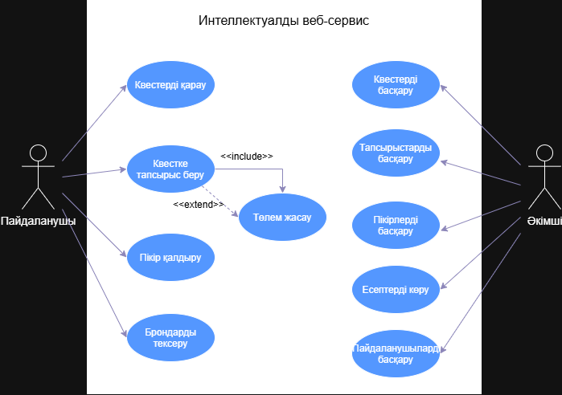
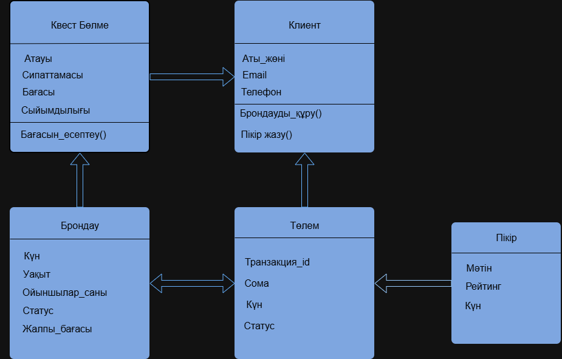
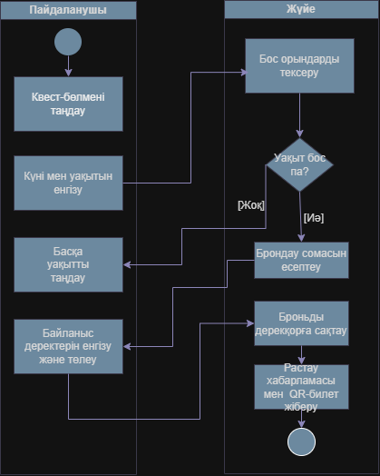
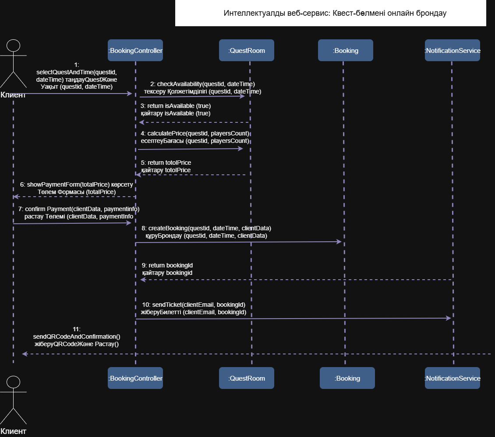

# Квест-бөлмелердің жұмысын автоматтандыру үшін Интеллектуалды веб-сервисті әзірлеу
Автор: Совет Аяжан, ВТиПОук-25-5

## Мәселе
Квест-бөлмелердегі брондау мен ойын процесін қолмен басқару уақыт жоғалтуға, сеанстардың қабаттасуына және клиенттерге қызмет көрсету сапасының төмендеуіне әкеледі. Бұл интеллектуалды веб-сервис квест клубтарының әкімшілері мен келушілеріне брондауды, төлемдерді және ойын кестесін толық автоматтандыруға мүмкіндік береді.

## Акторлар
- Клиент (Ойыншы)
- Әкімші (Оператор)

## Талаптар
### Функционалдық
1. Жүйе клиенттерге бос квест-бөлмелерді таңдап, онлайн брондауға мүмкіндік беруі керек.
2. Жүйе таңдалған уақыттың бос екенін автоматты түрде тексеруі керек.
3. Жүйе сәтті брондаудан кейін электронды билет пен растау хабарламасын жіберуі керек.

### Функционалдық емес
1. Веб-сервис тәулік бойы (24/7) үздіксіз және жылдам жұмыс істеуі тиіс.
2. Пайдаланушылардың дербес деректері мен төлем ақпараттары қорғалуы керек.

## Диаграммалар
### 1. Use Case
<!--  -->

### 2. Class
<!--  -->

### 3. Activity: Квест-бөлмені онлайн брондау

### 4. Sequence: Квест-бөлмені онлайн брондау
<!--  -->
